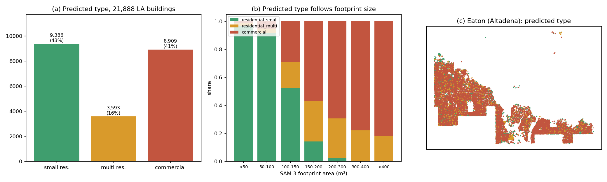

# Stage 2A LA v3 run — report

Run by Xihan Yao on the GISense lab server, 2026-10-14 (CT), following `RUN.md`.

## Environment

- **GPU:** one RTX A6000 (`CUDA_VISIBLE_DEVICES=0`).
- **Libraries:** torch 2.7.1+cu126 and torchvision 0.22.1+cu126, as listed in `RUN.md`. scikit-learn is 1.9.0.
- **Driver:** CUDA 12.8.
- **Release check:** `sha256sum -c SHA256SUMS` passed for both archives. `run_la.py --verify-only` reported "Verified 7 model artifacts".
- **Inputs:** product CSV `.../multidate_full_run_v3/building_damage_all_cells.csv`, SHA-256 `7c525076…755806`. The input layout was not changed and no `--path-map` was needed.

## Runs

| Run | Command difference | Result |
|---|---|---|
| `la_v3_smoke_100_allowex` | `--limit 100 --batch-size 32` | complete, 99 predicted, 1 excluded |
| `la_v3_full` (returned here) | `--batch-size 64` | **complete, 21,888 predicted, 136 excluded** |

The first smoke run without `--allow-exclusions` stopped on one excluded building, as designed. Both runs reported here therefore use `--allow-exclusions`.

**These outputs cover 21,888 of the 22,024 buildings, not all of them.**

## Exclusions: 136 buildings (0.6%)

- **Reason:** every one is "Mask must contain foreground and use 0/255 values". The saved `masks_M` PNG is entirely zero.
- **Which buildings:** all are very large footprints. The excluded buildings have a median area of 2,477 m² (range 294–49,960 m²). The buildings that were kept have a median of 152 m².
- **Damage status:** none of them is classified destroyed. 126 are "no damage" and 10 are "unknown".
- **Likely cause:** our 256 px shared-crop generator does not handle footprints larger than the crop window. The problem is in our inputs, not in your runner. The list is in `excluded_inputs.csv`.

## Visual check

`visual_check_sample.png` shows six random buildings per predicted class, with the mask outline in magenta.

**Alignment.** Crops and masks line up with the buildings, and the pixel scale looks right.

**Building type.** This looks unreliable on LA. Four of the six "commercial" samples and most of the "residential_multi" samples are single-family houses. The predicted class follows footprint area closely:

| Footprint | residential_small | residential_multi | commercial |
|---|---:|---:|---:|
| ≤ 100 m² | 0.94 | 0.03 | 0.04 |
| 100–200 m² | 0.34 | 0.23 | 0.42 |
| 200–400 m² | 0.02 | 0.26 | 0.72 |
| > 400 m² | 0.00 | 0.18 | 0.82 |

The run predicts 8,909 commercial buildings (41%). The Palisades and Eaton (Altadena) areas are mostly single-family homes, so that share looks far too high. A plausible cause is that LA houses are larger than the Harris County houses the model was trained on.

Assessor use codes, joined through the LARIAC `AIN`, would measure this properly. Median `pred_type_conf` is 0.65 and the median ensemble entropy is 0.71.

## Summary figure

`stage2a_findings.png` has three panels:

- **(a)** Predicted type counts.
- **(b)** Type share by footprint area.
- **(c)** Predicted type over Eaton (Altadena).

The type mix is about the same for destroyed buildings and for undamaged ones (about 40% commercial in each). The median `pred_population` is 4.7 for commercial, 3.5 for multi-residential and 0.4 for small residential. The population proxy therefore inherits the type pattern.

## Files

The `la_v3_full/` output folder holds everything requested in `RUN.md` §4:

- `stage2a_predictions.csv`
- `raw_predictions.csv`
- `stage2a_input.csv`
- `input_audit.json`
- `excluded_inputs.csv`
- `prediction_summary.json`
- `run_manifest.json` (`status: complete`)
- `inference.log`

It also includes the smoke-run folder and the visual-check image.
